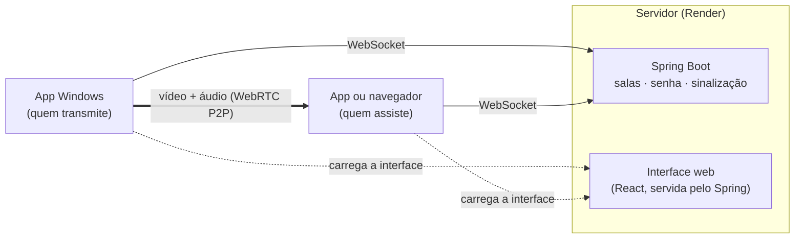
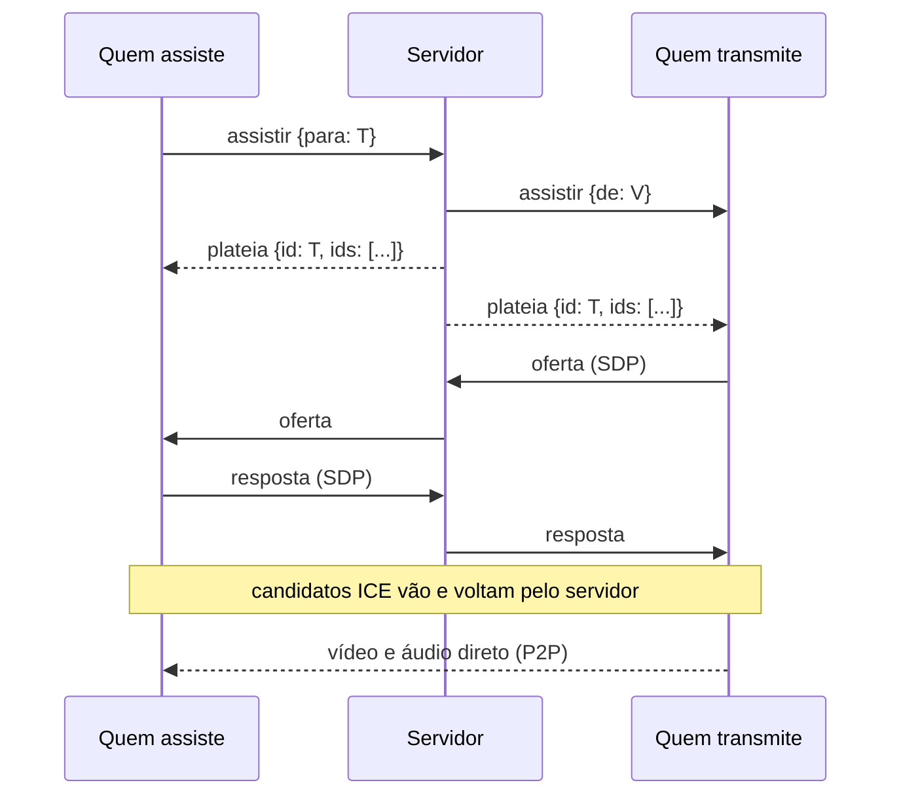

<div align="center">


# Ozamigos Share

**Transmita seu jogo para os amigos em até 1080p, direto de um PC para o outro.**

App para Windows e versão web, com salas protegidas por senha, várias transmissões ao mesmo tempo
e som do PC sem o eco do Discord.


[**Baixar para Windows**](../../releases/latest) · [Como funciona](#como-funciona) · [Rodar localmente](#rodar-localmente) · [Deploy](#deploy-no-render) · [Publicar uma versão](#publicar-uma-versão-do-app)

</div>

---

## Sumário

- [Recursos](#recursos)
- [Instalação (para quem só vai usar)](#instalação-para-quem-só-vai-usar)
- [Como funciona](#como-funciona)
- [Estrutura do repositório](#estrutura-do-repositório)
- [Requisitos de desenvolvimento](#requisitos-de-desenvolvimento)
- [Rodar localmente](#rodar-localmente)
- [Deploy no Render](#deploy-no-render)
- [Publicar uma versão do app](#publicar-uma-versão-do-app)
- [O que fazer quando algo muda](#o-que-fazer-quando-algo-muda)
- [Configuração](#configuração)
- [Protocolo de sinalização](#protocolo-de-sinalização)
- [Qualidade, banda e diagnóstico](#qualidade-banda-e-diagnóstico)
- [Segurança](#segurança)
- [Testes](#testes)
- [Problemas comuns](#problemas-comuns)
- [Limitações conhecidas](#limitações-conhecidas)
- [Licença](#licença)

---

## Recursos

**Na sala**
- **Presença em tempo real:** quem está na sala, quem está **ao vivo** e quantas pessoas assistem cada transmissão.
- **Assistir sob demanda:** você escolhe uma ou mais transmissões. O vídeo só sai do PC de quem transmite para quem clicou em **Assistir**, o que poupa o upload e a placa de vídeo de quem transmite.
- **Todos podem transmitir ao mesmo tempo**, em salas de até 5 pessoas.
- **Layouts:** **Grade**, com tudo lado a lado, ou **Destaque**, com uma transmissão grande e as outras em miniatura. Dois cliques no vídeo abrem a tela cheia, e o botão **Janela flutuante** solta a transmissão numa janelinha que fica por cima do jogo.
- **Áudio por transmissão:** volume e silenciar de cada uma, lembrados por amigo, mais um volume geral.
- **Qualidade ajustável ao vivo:** 1080p ou 720p, a 30 ou 60 fps, sem derrubar ninguém. Cada transmissão mostra um indicador de saúde (verde, amarelo ou vermelho), e o painel de **Estatísticas** mostra fps, resolução, taxa, codificador e o motivo de qualquer queda.
- **Avisos:** quando alguém entra ou começa a transmitir, aparece um aviso com o botão **Assistir**. Há sons curtos, que dá para desligar, e notificação do Windows quando o app está atrás do jogo.
- **Volta automática:** se quem você assiste para e volta a transmitir, você volta a assistir sem clicar em nada.
- **Reconexão automática:** se a internet oscilar ou o servidor reiniciar, o app volta sozinho para a sala. Quem transmitia continua transmitindo, e quem assistia continua assistindo. As transmissões já abertas não param enquanto isso.

**Só no app para Windows**
- **Seletor próprio** de janelas e telas, com miniaturas e ícones.
- **Som do PC sem eco:** captura o som de todos os programas, menos o **Discord** e o próprio **Ozamigos Share**. Os amigos não ouvem a própria voz nem o próprio jogo de volta. O áudio vai em estéreo.
- **Sem engasgos atrás do jogo:** a janela não é freada pelo Windows quando fica escondida.
- **Atualização automática da interface:** o app carrega a interface do servidor, então cada deploy chega a todos sem reinstalar.

---

## Instalação (para quem só vai usar)

1. Baixe o `Ozamigos-Share-Instalador-x.y.z.exe` na [última versão](../../releases/latest).
2. Abra o arquivo. Se o Windows mostrar **"O Windows protegeu o computador"**, clique em **Mais informações** e depois em **Executar assim mesmo**. O instalador não tem assinatura digital paga.
3. Entre com o seu nome e a **senha do grupo**, que quem administra o servidor passa para você.

**Sem instalar:** use o `Ozamigos-Share-Portatil-x.y.z.exe`, que abre com dois cliques.

**Pelo navegador:** abra o endereço do servidor no Chrome ou no Edge. Pelo navegador dá para assistir e transmitir, mas o som do PC vai inteiro, sem a exclusão do Discord.

**Requisitos:** Windows 10 (versão 2004 ou mais nova) ou Windows 11, 64 bits.

---

## Como funciona

O vídeo nunca passa pelo servidor. O servidor Java só apresenta as pessoas umas às outras (sinalização por WebSocket) e confere a senha. Depois disso, cada PC manda o vídeo direto para quem pediu, por WebRTC.



**Assistir sob demanda:** quem transmite só abre uma conexão de vídeo para quem pediu.



**Som do PC sem o Discord.** O Windows 10 (2004+) e o 11 capturam o som **de um programa (e dos que ele abriu) por vez**. O auxiliar `OzamigosSom.exe` (C#), que vai dentro do instalador:

1. confere, a cada 2 segundos, quais programas estão tocando som, em todas as saídas ativas;
2. captura cada um deles com o *loopback* de processo do Windows, menos o Discord (`Discord.exe`, `DiscordPTB.exe`, `DiscordCanary.exe`) e o processo do próprio app;
3. mistura tudo a 48 kHz em estéreo e entrega ao app pela saída padrão.

No app, um `AudioWorklet` transforma esse fluxo numa faixa de áudio que vai junto com o vídeo. O auxiliar:
- roda sem janela;
- liga quando a transmissão com som começa e desliga quando ela para;
- fecha sozinho se o app fechar.

Num Windows que não tenha esse recurso, o app volta a mandar o som do sistema inteiro.

---

## Estrutura do repositório

```text
.
├── src/                    Servidor Java (Spring Boot)
│   ├── main/java/dev/ozamigos/
│   │   ├── SinalizacaoHandler.java   WebSocket /sinal: entrada, plateias e repasse de SDP/ICE
│   │   ├── Salas.java                Estado das salas em memória (participantes e plateias)
│   │   ├── SenhaDoGrupo.java         Senha do grupo (variável de ambiente, comparação em tempo constante)
│   │   └── WebSocketConfig.java      Registro do /sinal e limite de mensagem
│   └── test/                         Testes (JUnit + AssertJ)
├── web/                    Interface (React 19 + TypeScript + Vite)
│   └── src/
│       ├── cliente.ts                Núcleo: sinalização, WebRTC, qualidade e estatísticas
│       ├── somDoApp.ts               Faixa de áudio do auxiliar de som (AudioWorklet)
│       ├── ponte.ts                  Contrato com o app Electron
│       └── componentes/              Entrada, Sala, BarraLateral, Palco, Transmissao, ...
├── desktop/                App para Windows (Electron 44)
│   ├── main.js                       Janela, permissões, seletor de fontes e auxiliar de som
│   ├── preload.js                    Ponte segura entre a página e o app
│   ├── inicio.html|js|css            Tela de escolher o servidor
│   ├── build/                        Ícone (e o script que o gera)
│   └── som/                          Auxiliar de som em C# (.NET 10): OzamigosSom.exe
├── Dockerfile              Build em 3 etapas: Node (interface) → JDK (servidor) → JRE (imagem final)
└── pom.xml
```

O build da interface (`web/`) grava em `src/main/resources/static/`. A pasta não é versionada; o Dockerfile a monta no deploy.

---

## Requisitos de desenvolvimento

| Ferramenta | Versão | Para quê |
|---|---|---|
| JDK | 25 | Servidor. O Maven vem pelo `mvnw`, sem instalar |
| Node.js | 22 ou mais novo | Interface e app Electron |
| .NET SDK | 10 | Compilar o auxiliar de som. Só para gerar o instalador |
| GitHub CLI (`gh`) | qualquer recente | Criar repositório e releases (opcional) |
| Chrome ou Edge | atual | Testar pelo navegador |

---

## Rodar localmente

Os comandos estão em PowerShell, um por linha, a partir da raiz do repositório.

**1. Monte a interface** (de novo sempre que mexer em `web/`):
```powershell
cd web
npm install
npm run build
cd ..
```

**2. Suba o servidor:**
```powershell
$env:OZAMIGOS_SENHA = "teste"
.\mvnw.cmd spring-boot:run
```
Abra `http://localhost:8080` e entre com a senha `teste`.

**3. (Opcional) Interface com recarga instantânea.** Com o servidor rodando, numa outra janela do terminal:
```powershell
cd web
npm run dev
```
Abra `http://localhost:5173`. O Vite repassa o WebSocket `/sinal` para a porta 8080.

**4. (Opcional) O app Electron apontando para o seu PC:**
```powershell
cd desktop
npm install
npm run som
npm start
```
Na tela de início, use `http://localhost:8080`. O app só aceita `http://` para `localhost`; qualquer outro endereço precisa de `https://`.

**Testar o som sem eco no mesmo PC:** a aba do navegador onde você faz o papel do amigo não está na lista de exclusão. Silencie a transmissão nessa aba, senão o som recebido volta para a transmissão. Para ouvir de verdade, use outro PC na mesma rede (`http://IP-DO-SEU-PC:8080`).

---

## Deploy no Render

1. **Crie o repositório e envie o código:**
   ```powershell
   gh repo create ozamigos-share-app --private --source=. --push
   ```
2. No [Render](https://dashboard.render.com), clique em **New** → **Web Service** e escolha o repositório. Se ele não aparecer, clique em **Configure account** e libere o acesso a ele no GitHub.
3. Preencha:
   - **Language:** Docker;
   - **Branch:** `main`;
   - **Instance Type:** Free (ou Starter, para não dormir).
4. Em **Environment Variables**, adicione `OZAMIGOS_SENHA` com a senha do grupo.
5. Clique em **Deploy Web Service**. O build leva de 5 a 10 minutos e termina com `Tomcat started on port 10000` no log.

A cada `git push` na `main`, o Render publica de novo sozinho.

**Plano Free:**
- O serviço dorme depois de 15 minutos sem uso e leva cerca de 1 minuto para acordar.
- Enquanto alguém está numa sala, o ping do app a cada 30 segundos o mantém acordado.
- Um deploy ou reinício derruba as salas abertas por alguns segundos; o app reconecta sozinho.

---

## Publicar uma versão do app

**1. Configure o endereço do servidor** em `desktop/package.json`:
```json
"ozamigos": {
  "servidor": "https://ozamigos-share-app.onrender.com"
}
```

**2. Aumente a versão** em `desktop/package.json` (ex.: `"version": "1.0.2"`).

**3. Grave, envie o código e a marca da versão:**
```powershell
git add desktop/package.json
git commit -m "App 1.0.2: o que mudou"
git push
git tag v1.0.2
git push origin v1.0.2
```

**4. Pronto.** A marca `v1.0.2` dispara o workflow [`.github/workflows/release.yml`](.github/workflows/release.yml), que, numa máquina Windows do GitHub:
- confere se a marca bate com a versão do `desktop/package.json`;
- compila o auxiliar de som (.NET) e empacota o app (electron-builder);
- cria a release com o `Ozamigos-Share-Instalador-1.0.2.exe` e o `Ozamigos-Share-Portatil-1.0.2.exe`.

Acompanhe na aba **Actions** do repositório (leva de 5 a 10 minutos) ou com `gh run watch`.

> **Custo:** repositório público não gasta nada. Repositório privado usa a cota grátis do GitHub Actions (2.000 minutos por mês no plano Free; a máquina Windows conta em dobro). Sem cartão cadastrado, o GitHub não cobra: se a cota acabar, o workflow só para até o mês seguinte.

**Gerar na sua máquina** (para testar o instalador antes, ou sem o GitHub):
```powershell
cd desktop
npm install
npm run instalador
```
Em `desktop\dist` saem o `Ozamigos-Share-Instalador-x.y.z.exe` (instala com atalhos e entra em "Adicionar ou remover programas") e o `Ozamigos-Share-Portatil-x.y.z.exe` (roda sem instalar). Para publicar à mão: `gh release create v1.0.2 desktop\dist\Ozamigos-Share-Instalador-1.0.2.exe desktop\dist\Ozamigos-Share-Portatil-1.0.2.exe --title "Ozamigos Share 1.0.2" --generate-notes`.

**Para corrigir uma release errada:** apague a release e a marca (o código não é afetado) e crie de novo.
```powershell
gh release delete v1.0.1 --cleanup-tag --yes
```

**Link fixo para os amigos** (com o repositório público): `https://github.com/<usuário>/ozamigos-share-app/releases/latest`

---

## O que fazer quando algo muda

| Mudou… | Precisa | Os usuários precisam… |
|---|---|---|
| Interface (`web/`) ou servidor (`src/`) | `git push` (o Render publica sozinho) | Nada; no máximo Ctrl+R no app |
| App (`desktop/`: `main.js`, `preload.js`, tela de início, auxiliar de som, ícone, endereço) | Aumentar a versão, `git push` e enviar a marca `vX.Y.Z` (o GitHub gera a release) | Baixar e instalar o `.exe` novo, por cima do antigo (as configurações continuam) |
| Senha do grupo | Editar `OZAMIGOS_SENHA` no Render (**Environment**) | Digitar a senha nova |

---

## Configuração

**Servidor**

| Variável | Obrigatória | Padrão | Descrição |
|---|---|---|---|
| `OZAMIGOS_SENHA` | sim | — | Senha do grupo. Sem ela, o servidor não sobe |
| `PORT` | não | `8080` | Porta HTTP. O Render define `10000` |

**App para Windows**

| Onde | O quê |
|---|---|
| `desktop/package.json` → `ozamigos.servidor` | Endereço do servidor que vem no instalador |
| `%APPDATA%\Ozamigos Share\configuracao.json` | Endereço escolhido pela pessoa (tem prioridade) e posição da janela |
| `desktop/main.js` → `SEM_SOM_DE` | Programas cujo som nunca vai na transmissão |
| Variável `OZAMIGOS_SERVIDOR` | Força um endereço, útil em testes |

**Limites do servidor**

| Limite | Valor |
|---|---|
| Pessoas por sala | 5 |
| Código da sala | 6 a 20 letras e números |
| Nome exibido | até 20 caracteres (vazio vira "Amigo") |
| Mensagem de sinalização | até 64 KB |

---

## Protocolo de sinalização

WebSocket em `/sinal`, com mensagens JSON que têm sempre o campo `tipo`. O servidor carimba o remetente (`de`) em tudo o que repassa; o cliente nunca informa quem ele é.

**Cliente → servidor**

| `tipo` | Campos | Efeito |
|---|---|---|
| `entrar` | `sala`, `senha`, `nome`, `ficha` (opcional) | Confere a senha e entra na sala. Na reconexão, a `ficha` recebida no `bem-vindo` anterior tira da sala a conexão antiga, se o servidor ainda não percebeu a queda |
| `comecei` / `parei` | — | Começa ou para de transmitir |
| `assistir` / `deixar` | `para` | Entra ou sai da plateia de quem transmite |
| `oferta` / `resposta` / `candidato` | `para`, `sdp` ou `candidato`, `canal` | Repassado só ao destinatário, na mesma sala |
| `ping` | — | Mantém a conexão viva (a cada 30 s); o servidor responde `pong` |

**Servidor → cliente**

| `tipo` | Campos | Quando |
|---|---|---|
| `bem-vindo` | `id`, `ficha`, `outros[]`, `compartilhando[]`, `plateias{}` | Ao entrar. A `ficha` é secreta: só quem a recebeu pode usá-la para reconectar |
| `pong` | — | Resposta ao `ping`. Sem nenhuma mensagem por 70 s, o cliente considera a conexão morta e reconecta |
| `entrou` / `saiu` | `id` (e `nome`) | Alguém entrou ou saiu |
| `pode-compartilhar` | — | Confirma o `comecei` |
| `compartilhando` / `parou` | `id` | Alguém começou ou parou de transmitir |
| `plateia` | `id`, `ids[]` | Mudou quem assiste uma transmissão |
| `assistir` / `deixar` | `de` | (para quem transmite) alguém quer assistir ou desistiu |
| `oferta` / `resposta` / `candidato` | `de`, ... | Repasse do WebRTC |
| `erro` | `motivo` | `senha-errada`, `sala-cheia`, `codigo-invalido`, `ja-esta-numa-sala`, `destinatario-nao-esta-na-sala`, ... |

Com `senha-errada` e `sala-cheia`, o servidor fecha a conexão logo depois de avisar.

---

## Qualidade, banda e diagnóstico

Cada pessoa que assiste é mais um vídeo saindo do PC de quem transmite. O codec de vídeo preferido é o H.264, codificado pela placa de vídeo; o áudio vai em Opus estéreo, a até 128 kbps.

| Qualidade | Upload por pessoa assistindo | Quando usar |
|---|---|---|
| 1080p · 30 fps (padrão) | ~5 Mbps | Imagem nítida, metade do trabalho do PC |
| 1080p · 60 fps | ~8 Mbps | Jogos rápidos, com upload sobrando |
| 720p · 60 fps | ~5 Mbps | Fluidez com menos banda |
| 720p · 30 fps | ~3 Mbps | Internet fraca |

Exemplo: em 1080p a 30 fps para 4 amigos, são cerca de 20 Mbps de upload. Nos primeiros 15 a 25 segundos, uma resolução menor é normal: o WebRTC está medindo a rede.

**Fps baixo ou travando.** Abra **Estatísticas** no PC de quem transmite:

| O que aparece | Significado | O que fazer |
|---|---|---|
| `Captura` abaixo da qualidade escolhida | O jogo ocupa a placa de vídeo inteira | Limite o fps do jogo (60 é o ideal) e use "janela sem bordas" |
| `Limite: processador / placa de vídeo` | O codificador não dá conta | 720p, fps do jogo limitado, driver atualizado |
| `Limite: internet` / `Banda estimada` baixa | O upload não aguenta | Baixe a qualidade, use cabo ou tenha menos gente assistindo |
| Indicador vermelho só em quem assiste | A internet de quem assiste | Cabo ou Wi-Fi mais perto do roteador |

---

## Segurança

- **Senha do grupo:**
  - fica só na variável de ambiente e nunca no código;
  - é conferida antes de qualquer outra coisa, então quem erra não descobre nada sobre a sala;
  - é comparada em tempo constante.
- **Origem do WebSocket:** só páginas servidas pelo próprio servidor conseguem abrir o WebSocket (checagem de origem do Spring).
- **Remetente carimbado:** o servidor diz quem enviou cada mensagem (`de`) e só repassa dentro da mesma sala.
- **App Electron:**
  - roda com `contextIsolation`, `sandbox` e sem `nodeIntegration`;
  - a página só acessa as funções da `preload.js`, e o `main.js` confere a origem de cada pedido;
  - permissões (tela, notificações, tela cheia) só valem para o endereço do servidor configurado;
  - links externos abrem no navegador.
- **Nomes:** aparecem como texto, nunca como HTML.

---

## Testes

```powershell
.\mvnw.cmd test
```

Os testes cobrem:
- o limite de pessoas por sala;
- o que quem chega depois recebe (transmissões e plateias);
- as regras de plateia;
- a senha do grupo;
- a subida da aplicação.

Para verificar os tipos da interface: `cd web` e depois `npm run typecheck`.

---

## Problemas comuns

| Sintoma | Causa provável | Solução |
|---|---|---|
| Servidor não sobe: "Defina a senha do grupo…" | Falta `OZAMIGOS_SENHA` | Defina a variável (no Render, em **Environment**) |
| `localhost:8080` dá 404 | Interface não montada | `cd web`, depois `npm install` e `npm run build` |
| App diz "Não foi possível abrir…" | Endereço errado, sem internet ou Render acordando | Confira o endereço; espere 1 minuto e clique em **Conectar** |
| App abre num endereço antigo | O endereço guardado tem prioridade sobre o do instalador | Ícone de servidor na sala, ou Alt → **Trocar o servidor** |
| Amigos ouvem o próprio som de volta | Transmissão pelo navegador (som do PC inteiro) | Transmita pelo app para Windows |
| Voz de chamada vai junto | Programa fora da lista (ex.: Discord no navegador) | Use o Discord instalado ou acrescente o programa em `SEM_SOM_DE` |
| Vídeo preto com o jogo em tela cheia | Tela cheia exclusiva não é capturável | "Janela sem bordas" ou transmita a tela inteira |
| "Não foi possível conectar direto com…" | 4G/5G, CGNAT ou rede corporativa | Outra rede. Esses casos exigem TURN (veja Limitações) |
| "A conexão com o servidor caiu. Reconectando…" | Render reiniciou ou a internet caiu | Espere: o app tenta de novo sozinho (1, 2, 5 e depois a cada 10 s). **Tentar agora** força uma tentativa |
| Comando com `&&` falha no terminal | O PowerShell 5 não aceita `&&` | Use `;` ou um comando por linha |

---

## Limitações conhecidas

- **Sem servidor TURN:** quem está atrás de CGNAT, em 4G/5G ou em rede corporativa pode não conseguir conectar. O TURN repassa o vídeo e tem custo por GB.
- **Senha única por servidor:** pensada para grupos de amigos, cada grupo com o próprio deploy. Para uso público, seriam necessários senha por sala e limite de tentativas.
- **Estado em memória:** as salas vivem num servidor só. Para mais de um servidor, seria preciso um armazenamento compartilhado (ex.: Redis).
- **Exclusão de som por grupo de processos:** programas abertos *a partir* do Discord ou do Ozamigos também ficam de fora. Jogos abertos pela Steam, pela Epic ou pelo menu Iniciar não são afetados.
- **Programa que começa a tocar no meio:** o som dele entra na transmissão em até 2 segundos.
- **Instalador sem assinatura digital:** o SmartScreen avisa na primeira execução.
- **Atualização do app:** a interface se atualiza sozinha; já o app em si (pasta `desktop/`) exige baixar o instalador novo.

---

## Licença

Distribuído sob a [licença MIT](LICENSE): pode usar, copiar, modificar e distribuir, inclusive para fins comerciais, desde que o aviso de copyright e a licença acompanhem as cópias. O software é fornecido sem garantia.
