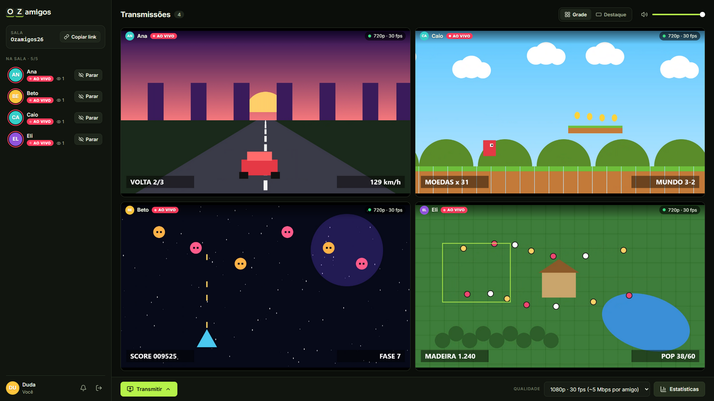
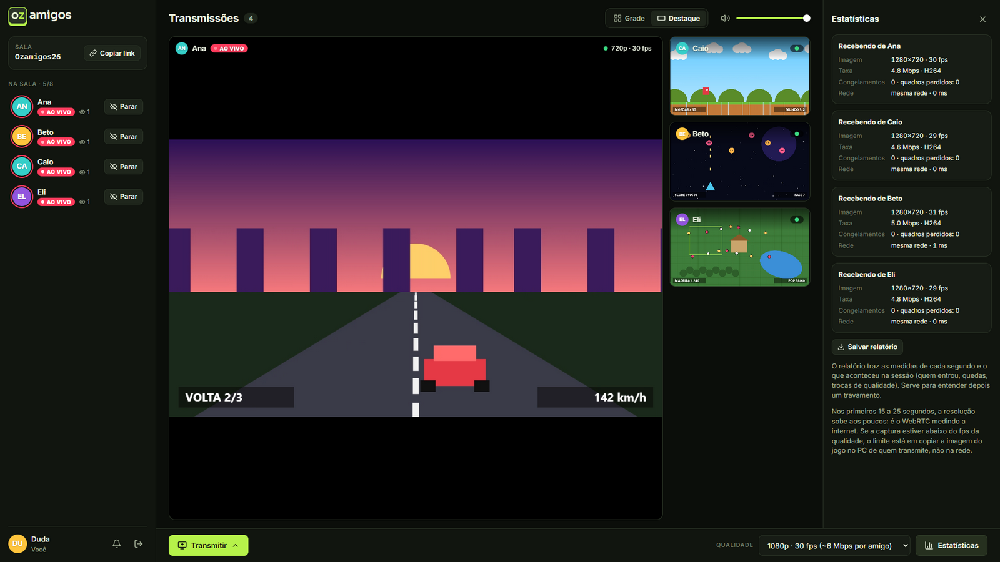
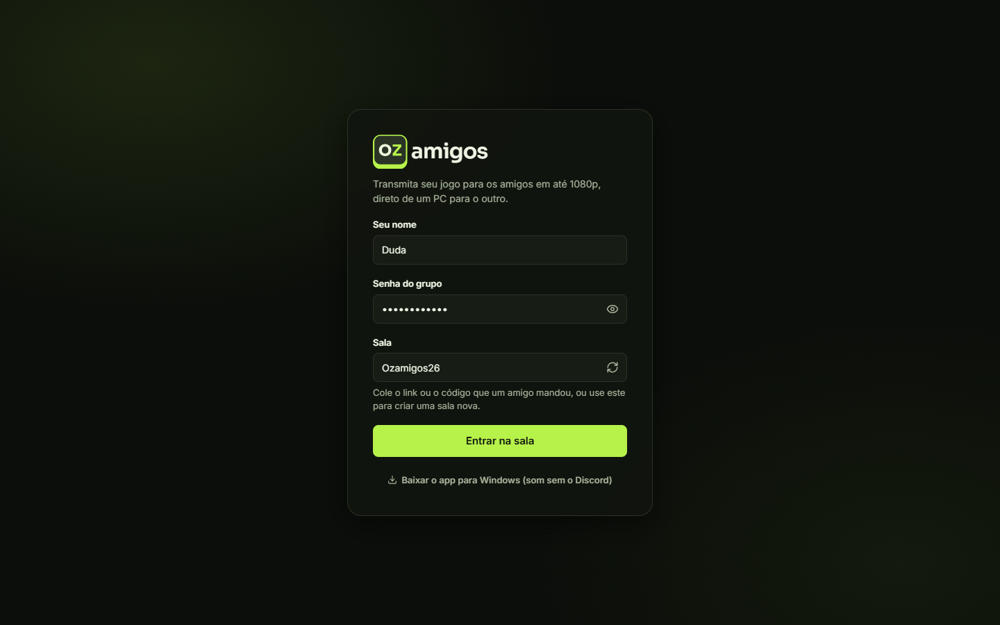
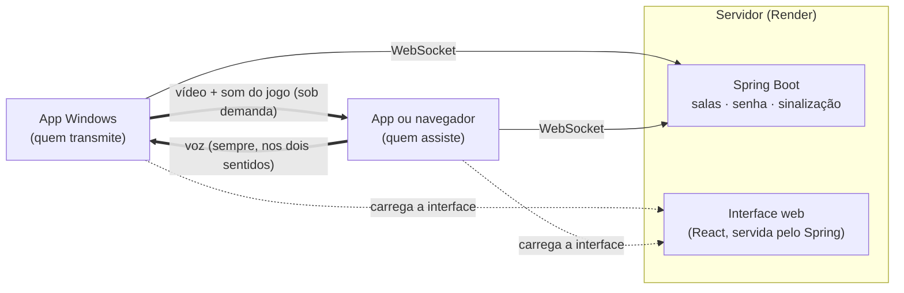
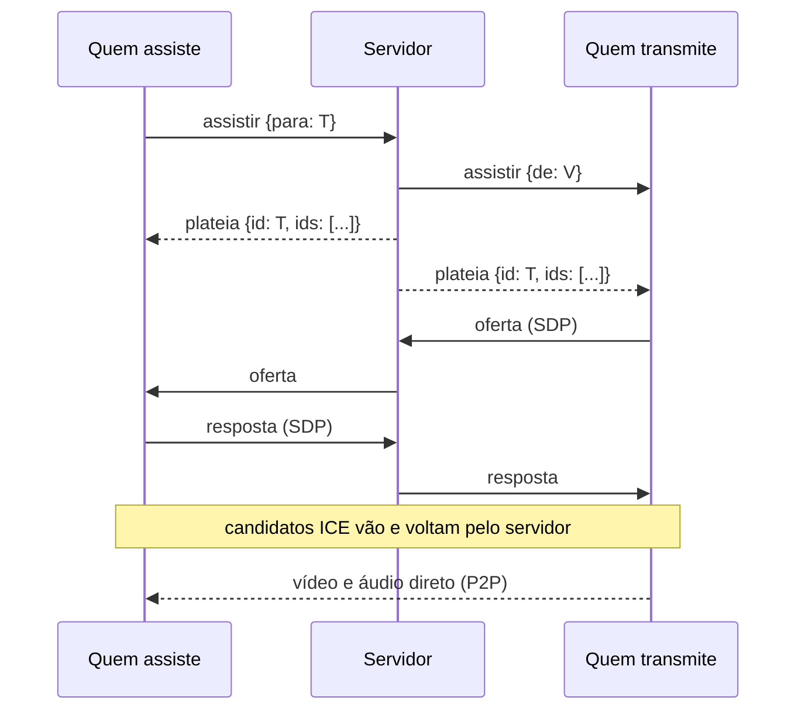
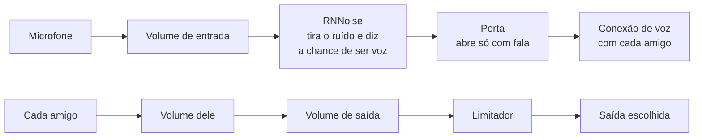

<br>

<p align="center">
  <picture>
    <source media="(prefers-color-scheme: dark)" srcset="docs/imagens/logo-tema-escuro.png">
    <source media="(prefers-color-scheme: light)" srcset="docs/imagens/logo-tema-claro.png">
    
  </picture>
</p>

<h3 align="center">Transmita seu jogo e converse com os amigos, direto de um PC para o outro.</h3>

<p align="center">
  Vídeo e voz com redução de ruído, sem servidor de mídia no meio.<br>
  App para Windows e versão web, com salas protegidas por senha e todo mundo transmitindo ao mesmo tempo.
</p>

<p align="center">
  <a href="../../releases/latest"></a>
  <a href="https://kayokalinauskas.github.io/ozamigos/"></a>
</p>

<p align="center">
  <a href="../../releases/latest"></a>
  <a href="../../actions/workflows/ci.yml"></a>
  <a href="../../releases"></a>
  
  
  
  
  
  
  
</p>

<p align="center">
  <a href="#recursos">Recursos</a> ·
  <a href="#instalação-para-quem-só-vai-usar">Instalação</a> ·
  <a href="#como-funciona">Como funciona</a> ·
  <a href="#rodar-localmente">Rodar localmente</a> ·
  <a href="#deploy-no-render">Deploy</a> ·
  <a href="#publicar-uma-versão-do-app">Publicar uma versão</a> ·
  <a href="CHANGELOG.md">Novidades</a>
</p>

---

## Sumário

- [Recursos](#recursos)
- [Instalação (para quem só vai usar)](#instalação-para-quem-só-vai-usar)
- [Como funciona](#como-funciona)
- [Estrutura do repositório](#estrutura-do-repositório)
- [Requisitos de desenvolvimento](#requisitos-de-desenvolvimento)
- [Rodar localmente](#rodar-localmente)
- [Deploy no Render](#deploy-no-render)
- [Publicar uma versão do app](#publicar-uma-versão-do-app)
- [O que fazer quando algo muda](#o-que-fazer-quando-algo-muda)
- [Configuração](#configuração)
- [Protocolo de sinalização](#protocolo-de-sinalização)
- [Qualidade, banda e diagnóstico](#qualidade-banda-e-diagnóstico)
- [Segurança](#segurança)
- [Testes](#testes)
- [Problemas comuns](#problemas-comuns)
- [Limitações conhecidas](#limitações-conhecidas)
- [Licença](#licença)

---

## Recursos

<table>
  <tr>
    <td width="50%"></td>
    <td width="50%"></td>
  </tr>
  <tr>
    <td align="center"><sub><b>Grade:</b> as transmissões lado a lado e, na lateral, quem está ao vivo, falando ou com o microfone desligado</sub></td>
    <td align="center"><sub><b>Destaque:</b> uma grande, as outras numa fileira, e as estatísticas de cada conexão</sub></td>
  </tr>
</table>

**Voz**
- **Entrou na sala, já está na conversa:** sem chamada para iniciar e sem outro programa. O microfone só abre quando você fala.
- **Redução de ruído com o RNNoise** (padrão), uma rede neural que roda no seu PC: teclado, mouse e ventilador não chegam aos amigos. Dá para trocar pela do navegador ou desligar.
- **Sensibilidade automática:** o microfone abre quando o RNNoise reconhece voz acima do barulho do ambiente. Ou manual, arrastando o limite sobre o medidor.
- **Microfone e som a um clique** no seu cartão (desligar o som desliga o microfone também). Os amigos veem o ícone, e quem está falando ganha um **anel verde**.
- **Engrenagem:** microfone e saída de áudio, volumes de entrada e de saída, teste do microfone, cancelamento de eco e controle automático de ganho.
- **Cada amigo do seu jeito:** clicando no nome, o volume da voz dele (até 200%) e "silenciar para mim", lembrados para as próximas vezes.
- **Baixo atraso:** a voz tem a própria conexão, separada do vídeo, em Opus a 64 kbps com correção de perda. Na bancada, na mesma rede, ela chega em 60 a 90 ms.
- **Sem estouro:** um limitador suave antes da caixa de som segura vários amigos falando juntos, ou um volume em 200%.

**Transmissões**
- **Presença em tempo real:** quem está na sala, quem está **ao vivo** e quantas pessoas assistem cada transmissão.
- **Assistir sob demanda:** você escolhe uma ou mais transmissões. O vídeo só sai do PC de quem transmite para quem clicou em **Assistir**, o que poupa o upload e a placa de vídeo de quem transmite.
- **Todos podem transmitir ao mesmo tempo**, em salas de até 8 pessoas.
- **Layouts:** **Grade**, com tudo lado a lado, ou **Destaque**, com uma transmissão grande e as outras em miniatura (ao lado ou numa fileira embaixo, conforme o espaço). Dois cliques no vídeo abrem a tela cheia, e o botão **Janela flutuante** solta a transmissão numa janelinha que fica por cima do jogo.
- **Áudio por transmissão:** volume e silenciar de cada uma, lembrados por amigo, mais um volume geral.
- **Pouco atraso para quem assiste:** a folga contra soluços da rede se ajusta à conexão de cada um, de 80 a 250 ms.
- **Sem escolher qualidade:** a transmissão sai sempre em 720p a 30 fps. Se a internet ou o PC apertarem, a imagem de quem não aguenta perde um pouco de nitidez ou de fps por alguns segundos, sem travar e sem sair de 720p; quem está bem nem percebe. Cada transmissão mostra um indicador de saúde (verde, amarelo ou vermelho), e o painel de **Estatísticas** mostra fps, resolução, taxa, codificador e o motivo de qualquer queda.
- **Avisos:** quando alguém entra ou começa a transmitir, aparece um aviso com o botão **Assistir**. Há sons curtos e notificação do Windows quando o app está atrás do jogo; na engrenagem (aba **Notificações**), dá para desligar os sons e escolher quais notificações aparecem: alguém entrou, começou a transmitir ou mandou mensagem no chat.
- **Configurações em abas:** Voz e áudio, Notificações e Geral (a versão e o servidor).
- **Volta automática:** se quem você assiste para e volta a transmitir, você volta a assistir sem clicar em nada.
- **Na bandeja, como o Discord** (app para Windows): fechar a janela deixa o Ozamigos perto do relógio, e a conversa continua; para sair, botão direito no ícone. Mensagens novas do chat aparecem como um ponto verde no ícone da barra de tarefas, que pisca quando chega uma com o jogo na frente.
- **A tela não apaga** com mais alguém na sala, como numa chamada.
- **Chat da sala:** mensagens de texto com links clicáveis, num painel à direita. Com o painel fechado, a mensagem aparece como aviso e o botão mostra quantas são novas. Nada fica guardado: quem entra depois não vê o que foi dito antes.
- **Reconexão automática:** se a internet oscilar ou o servidor reiniciar, o app volta sozinho para a sala. Quem transmitia continua transmitindo, e quem assistia continua assistindo. As transmissões já abertas não param enquanto isso.

**Só no app para Windows**
- **Seletor próprio** de janelas e telas, com miniaturas e ícones.
- **Som do jogo sem eco:** a transmissão leva o som de todos os programas do PC, menos o do próprio **Ozamigos** (a voz dos amigos e as transmissões que você assiste) e o de apps de chamada de voz. Ninguém ouve a própria voz nem o próprio jogo de volta. O áudio vai em estéreo.
- **Sem engasgos atrás do jogo:** a janela não é freada pelo Windows quando fica escondida, e a captura não cai para ~21 fps quando outro programa fica entre o jogo e o Ozamigos (desde a 1.2.14).
- **Se recupera sozinho:** se a página travar e cair, ela abre de novo; e a janela guardada num monitor que foi desligado volta para a tela.
- **Atualização automática da interface:** o app carrega a interface do servidor, então cada deploy chega a todos sem reinstalar.
- **Convites que abrem o app:** um link `ozamigos://sala/CODIGO` abre o Ozamigos instalado direto na sala (com o app aberto em outra sala, ele pergunta antes). No navegador do Windows, o link de uma sala pergunta antes: **abrir no app**, **baixar o app** ou **continuar no navegador** (e lembra a escolha).
- **O app se atualiza sozinho** (a partir da 1.2.0, na versão instalada): ao abrir, ele procura uma versão nova nas releases, baixa, instala e abre de novo. A versão portátil continua sendo atualizada à mão.

---

## Instalação (para quem só vai usar)

1. Baixe o `Ozamigos-Instalador-x.y.z.exe` na [última versão](../../releases/latest).
2. Abra o arquivo. Se o Windows mostrar **"O Windows protegeu o computador"**, clique em **Mais informações** e depois em **Executar assim mesmo**. O instalador não tem assinatura digital paga.
3. Entre com o seu nome e a **senha do grupo**, que quem administra o servidor passa para você.
4. Pronto: você já está na conversa. Na primeira vez, permita o microfone. Para escolher o microfone ou a saída de áudio, clique na engrenagem do seu cartão, no canto de baixo.

<p align="center"></p>

**Sem instalar:** use o `Ozamigos-Portatil-x.y.z.exe`, que abre com dois cliques.

**Pelo navegador:** abra o endereço do servidor no Chrome ou no Edge. A entrada tem um link para o [site](https://kayokalinauskas.github.io/ozamigos/), que apresenta e baixa o app para Windows. Pelo navegador dá para conversar, assistir e transmitir, mas a transmissão leva o som do PC inteiro, sem a separação que o app faz. **No celular**, pelo navegador, dá para assistir e conversar; transmitir, só do computador.

**Requisitos:** Windows 10 (versão 2004 ou mais nova) ou Windows 11, 64 bits.

---

## Como funciona

Nem a voz nem o vídeo passam pelo servidor. O servidor Java só apresenta as pessoas umas às outras (sinalização por WebSocket) e confere a senha. Depois disso, tudo vai direto de um PC para o outro, por WebRTC:

- **Voz:** cada par de pessoas da sala tem uma conexão só de voz, aberta assim que alguém entra.
- **Vídeo e som do jogo:** saem do PC de quem transmite só para quem clicou em **Assistir**.



**Assistir sob demanda:** quem transmite só abre uma conexão de vídeo para quem pediu.



**A voz.** O microfone passa por um processador de áudio que roda numa thread própria (`AudioWorklet`), em quadros de 10 ms:



- A **porta** abre quando o RNNoise dá mais de 50% de chance de voz e o volume está acima do ruído do ambiente, que ela acompanha sozinha. Ela segura 350 ms depois da última sílaba, para não cortar o fim das palavras.
- **Mudo** manda silêncio pela mesma conexão, então ligar de novo é instantâneo. O estado de mudo e de som desligado vai para os amigos por um canal de dados da própria conexão.
- Quem chega (ou volta depois de cair) liga para todos os que já estavam. Assim, dois nunca ligam um para o outro ao mesmo tempo. Se a conexão cair, quem ligou tenta de novo, até 3 vezes.

**Som do jogo sem eco.** O Windows 10 (2004+) e o 11 capturam o som **de um programa (e dos que ele abriu) por vez**. O auxiliar `OzamigosSom.exe` (C#), que vai dentro do instalador:

1. confere, a cada 2 segundos, quais programas estão tocando som, em todas as saídas ativas;
2. captura cada um deles com o *loopback* de processo do Windows, menos o processo do próprio app (que toca a voz e as transmissões) e os apps de chamada de voz da lista `SEM_SOM_DE`;
3. mistura tudo a 48 kHz em estéreo e entrega ao app pela saída padrão.

No app, um `AudioWorklet` transforma esse fluxo numa faixa de áudio que vai junto com o vídeo. O auxiliar:
- roda sem janela;
- liga quando a transmissão com som começa e desliga quando ela para;
- fecha sozinho se o app fechar.

Num Windows que não tenha esse recurso, o app volta a mandar o som do sistema inteiro.

---

## Estrutura do repositório

```text
.
├── src/                    Servidor Java (Spring Boot)
│   ├── main/java/dev/ozamigos/
│   │   ├── SinalizacaoHandler.java   WebSocket /sinal: entrada, plateias e repasse de SDP/ICE
│   │   ├── Salas.java                Estado das salas em memória (participantes e plateias)
│   │   ├── SenhaDoGrupo.java         Senha do grupo (variável de ambiente, comparação em tempo constante)
│   │   ├── TentativasDeSenha.java    Freio de senhas erradas por endereço (10 a cada 5 minutos)
│   │   └── WebSocketConfig.java      Registro do /sinal e limite de mensagem
│   └── test/                         Testes do servidor (JUnit + AssertJ), com a sinalização de ponta a ponta
├── web/                    Interface (React 19 + TypeScript + Vite)
│   └── src/
│       ├── cliente.ts                Núcleo: a sala, transmitir, assistir e as conexões de vídeo
│       ├── conexao/                  Peças do núcleo: protocolo (mensagens com tipo), sinalização (WebSocket e
│       │                             reconexão), captura, medidor (estatísticas), relatório e ajustes do WebRTC
│       ├── voz/                      Conversa por voz: conexões, processador (RNNoise e porta) e ajustes
│       ├── folga.ts                  Folga de rede do vídeo, ajustada à conexão de cada um
│       ├── qualidade.ts              A qualidade da transmissão (720p a 30 fps, sempre)
│       ├── somDoApp.ts               Faixa de áudio do auxiliar de som (AudioWorklet)
│       ├── ponte.ts                  Contrato com o app Electron
│       ├── desempenho/               Teste de desempenho e gravação da sala: medição, análise e os relatórios (HTML e para IA)
│       └── componentes/              Entrada, Sala, BarraLateral, Palco, Transmissao, ...
├── site/                   Site de apresentação em português e inglês (en/), publicado no GitHub Pages
├── desktop/                App para Windows (Electron 44)
│   ├── main.js                       Janela, permissões, seletor de fontes e auxiliar de som
│   ├── preload.js                    Ponte segura entre a página e o app
│   ├── inicio.html|js|css            Tela de escolher o servidor
│   ├── build/                        Ícone (e o script que o gera) e a fonte do logotipo
│   └── som/                          Auxiliar em C# (.NET 10): OzamigosSom.exe (som do PC; com --contadores, uso da placa de vídeo)
├── docs/imagens/           Logotipo, telas e GIF de demonstração deste README
├── docs/vitrine/           Scripts que geram as imagens de docs/imagens
├── .github/                CI, release do app, site, Dependabot e modelos de issue e PR
├── CHANGELOG.md            Histórico de versões do app
├── Dockerfile              Build em 3 etapas: Node (interface) → JDK (servidor) → JRE (imagem final)
└── pom.xml
```

O build da interface (`web/`) grava em `src/main/resources/static/`. A pasta não é versionada; o Dockerfile a monta no deploy.

---

## Requisitos de desenvolvimento

| Ferramenta | Versão | Para quê |
|---|---|---|
| JDK | 25 | Servidor. O Maven vem pelo `mvnw`, sem instalar |
| Node.js | 22 ou mais novo | Interface e app Electron |
| .NET SDK | 10 | Compilar o auxiliar de som. Só para gerar o instalador |
| GitHub CLI (`gh`) | qualquer recente | Criar repositório e releases (opcional) |
| Chrome ou Edge | atual | Testar pelo navegador |

---

## Rodar localmente

Os comandos estão em PowerShell, um por linha, a partir da raiz do repositório.

**1. Monte a interface** (de novo sempre que mexer em `web/`):
```powershell
cd web
npm install
npm run build
cd ..
```

**2. Suba o servidor:**
```powershell
$env:OZAMIGOS_SENHA = "teste"
.\mvnw.cmd spring-boot:run
```
Abra `http://localhost:8080` e entre com a senha `teste`.

**3. (Opcional) Interface com recarga instantânea.** Com o servidor rodando, numa outra janela do terminal:
```powershell
cd web
npm run dev
```
Abra `http://localhost:5173`. O Vite repassa o WebSocket `/sinal` para a porta 8080.

**4. (Opcional) O app Electron apontando para o seu PC:**
```powershell
cd desktop
npm install
npm run som
npm start
```
Na tela de início, use `http://localhost:8080`. O app só aceita `http://` para `localhost`; qualquer outro endereço precisa de `https://`.

**Testar a voz no mesmo PC:** abra a sala em duas janelas (ou no app e no navegador). Use fone e silencie uma das janelas, senão o som de uma volta pelo microfone da outra.

**Testar o som sem eco no mesmo PC:** a aba do navegador onde você faz o papel do amigo não está na lista de exclusão. Silencie a transmissão nessa aba, senão o som recebido volta para a transmissão. Para ouvir de verdade, use outro PC na mesma rede (`http://IP-DO-SEU-PC:8080`).

---

## Deploy no Render

1. **Tenha o código num repositório seu:** faça um *fork* deste no GitHub, ou envie uma cópia com:
   ```powershell
   gh repo create ozamigos --private --source=. --push
   ```
2. No [Render](https://dashboard.render.com), clique em **New** → **Web Service** e escolha o repositório. Se ele não aparecer, clique em **Configure account** e libere o acesso a ele no GitHub.
3. Preencha:
   - **Name:** o nome vira o endereço (`ozamigos` → `https://ozamigos.onrender.com`);
   - **Language:** Docker;
   - **Branch:** `main`;
   - **Instance Type:** Free (ou Starter, para não dormir).
4. Em **Environment Variables**, adicione `OZAMIGOS_SENHA` com a senha do grupo.
5. Em **Advanced** → **Health Check Path**, coloque `/actuator/health`: o Render confere por ele se o servidor está de pé e o reinicia se travar. (Num serviço que já existe, fica em **Settings** → **Health Checks**.)
6. Clique em **Deploy Web Service**. O build leva de 5 a 10 minutos e termina com `Tomcat started on port 10000` no log.

A cada `git push` na `main`, o Render publica de novo sozinho. Depois, coloque o endereço do seu serviço em `desktop/package.json` (`ozamigos.servidor`) e gere o instalador: é o endereço com que o app abre.

**Plano Free:**
- O serviço dorme depois de 15 minutos sem uso e leva cerca de 1 minuto para acordar.
- Enquanto alguém está numa sala, o ping do app a cada 30 segundos o mantém acordado.
- Um deploy ou reinício derruba as salas abertas por alguns segundos; o app reconecta sozinho.

---

## Publicar uma versão do app

**1. Configure o endereço do servidor** em `desktop/package.json`:
```json
"ozamigos": {
  "servidor": "https://ozamigos.onrender.com"
}
```

**2. Aumente a versão** em `desktop/package.json` (ex.: `"version": "1.0.2"`).

**3. Grave, envie o código e a marca da versão:**
```powershell
git add desktop/package.json
git commit -m "App 1.0.2: o que mudou"
git push
git tag v1.0.2
git push origin v1.0.2
```

**4. Pronto.** A marca `v1.0.2` dispara o workflow [`.github/workflows/release.yml`](.github/workflows/release.yml), que, numa máquina Windows do GitHub:
- confere se a marca bate com a versão do `desktop/package.json`;
- compila o auxiliar de som (.NET) e empacota o app (electron-builder);
- cria a release com o `Ozamigos-Instalador-1.0.2.exe` e o `Ozamigos-Portatil-1.0.2.exe`, mais o `latest.yml` e o `.blockmap`, que o app instalado lê para se atualizar sozinho.

Acompanhe na aba **Actions** do repositório (leva de 5 a 10 minutos) ou com `gh run watch`.

> **Custo:** repositório público não gasta nada. Repositório privado usa a cota grátis do GitHub Actions (2.000 minutos por mês no plano Free; a máquina Windows conta em dobro). Sem cartão cadastrado, o GitHub não cobra: se a cota acabar, o workflow só para até o mês seguinte.

**Gerar na sua máquina** (para testar o instalador antes, ou sem o GitHub):
```powershell
cd desktop
npm install
npm run instalador
```
Em `desktop\dist` saem o `Ozamigos-Instalador-x.y.z.exe` (instala com atalhos e entra em "Adicionar ou remover programas") e o `Ozamigos-Portatil-x.y.z.exe` (roda sem instalar). Para publicar à mão: `gh release create v1.0.2 desktop\dist\Ozamigos-Instalador-1.0.2.exe desktop\dist\Ozamigos-Portatil-1.0.2.exe --title "Ozamigos 1.0.2" --generate-notes`.

**Para corrigir uma release errada:** apague a release e a marca (o código não é afetado) e crie de novo.
```powershell
gh release delete v1.0.1 --cleanup-tag --yes
```

**Link fixo para os amigos:** `https://github.com/kayokalinauskas/ozamigos/releases/latest` (sempre a versão mais nova).

---

## O que fazer quando algo muda

| Mudou… | Precisa | Os usuários precisam… |
|---|---|---|
| Interface (`web/`) ou servidor (`src/`) | `git push` (o Render publica sozinho) | Nada; no máximo Ctrl+R no app |
| App (`desktop/`: `main.js`, `preload.js`, tela de início, auxiliar de som, ícone, endereço) | Aumentar a versão, `git push` e enviar a marca `vX.Y.Z` (o GitHub gera a release) | Nada: o app instalado se atualiza sozinho na próxima vez que abrir (a partir da 1.2.0). Quem usa a versão portátil, ou ainda está numa versão anterior à 1.2.0, baixa o `.exe` novo e instala por cima (as configurações continuam) |
| Senha do grupo | Editar `OZAMIGOS_SENHA` no Render (**Environment**) | Digitar a senha nova |

---

## Configuração

**Servidor**

| Variável | Obrigatória | Padrão | Descrição |
|---|---|---|---|
| `OZAMIGOS_SENHA` | sim | — | Senha do grupo. Sem ela, o servidor não sobe |
| `PORT` | não | `8080` | Porta HTTP. O Render define `10000` |

**App para Windows**

| Onde | O quê |
|---|---|
| `desktop/package.json` → `ozamigos.servidor` | Endereço do servidor que vem no instalador |
| `%APPDATA%\Ozamigos Share\configuracao.json` | Endereço escolhido pela pessoa (tem prioridade) e posição da janela. A pasta mantém o nome antigo do app, para ninguém perder as configurações |
| `desktop/main.js` → `SEM_SOM_DE` | Programas cujo som nunca vai na transmissão (apps de chamada de voz) |
| Variável `OZAMIGOS_SERVIDOR` | Força um endereço, útil em testes |

**Limites do servidor**

| Limite | Valor |
|---|---|
| Pessoas por sala | 8 |
| Código da sala | 6 a 20 letras e números |
| Nome exibido | até 20 caracteres (vazio vira "Amigo") |
| Mensagem de sinalização | até 64 KB |

**Voz:** os ajustes da engrenagem, o volume de cada amigo e o estado de mudo e de som desligado ficam no navegador ou no app de cada pessoa (`localStorage`). O servidor não guarda nada disso.

---

## Protocolo de sinalização

WebSocket em `/sinal`, com mensagens JSON que têm sempre o campo `tipo`. O servidor carimba o remetente (`de`) em tudo o que repassa; o cliente nunca informa quem ele é. Os tipos de cada mensagem estão em [`web/src/conexao/protocolo.ts`](web/src/conexao/protocolo.ts).

**Cliente → servidor**

| `tipo` | Campos | Efeito |
|---|---|---|
| `entrar` | `sala`, `senha`, `nome`, `ficha` (opcional) | Confere a senha e entra na sala. Na reconexão, a `ficha` recebida no `bem-vindo` anterior tira da sala a conexão antiga, se o servidor ainda não percebeu a queda |
| `comecei` / `parei` | — | Começa ou para de transmitir |
| `assistir` / `deixar` | `para` | Entra ou sai da plateia de quem transmite |
| `oferta` / `resposta` / `candidato` | `para`, `sdp` ou `candidato`, `canal` (`envio`, `recebimento` ou `voz`) | Repassado só ao destinatário, na mesma sala |
| `ping` | — | Mantém a conexão viva (a cada 30 s); o servidor responde `pong` |
| `gravar-sala` | `ligada` | Começa ou para a gravação das estatísticas da sala (uma por vez; só quem grava para) |
| `medidas` | `pacote` | As medidas deste segundo, entregues só a quem grava a sala (sem gravação, o servidor descarta) |
| `chat` | `texto` | Uma mensagem para a sala (até 500 caracteres; no máximo 5 a cada 3 s por pessoa) |

**Servidor → cliente**

| `tipo` | Campos | Quando |
|---|---|---|
| `bem-vindo` | `id`, `ficha`, `outros[]`, `compartilhando[]`, `plateias{}`, `gravando` (`id`, `nome`, se alguém grava a sala) | Ao entrar. A `ficha` é secreta: só quem a recebeu pode usá-la para reconectar |
| `pong` | — | Resposta ao `ping`. Sem nenhuma mensagem por 70 s, o cliente considera a conexão morta e reconecta |
| `entrou` / `saiu` | `id` (e `nome`) | Alguém entrou ou saiu |
| `pode-compartilhar` | — | Confirma o `comecei` |
| `compartilhando` / `parou` | `id` | Alguém começou ou parou de transmitir |
| `plateia` | `id`, `ids[]` | Mudou quem assiste uma transmissão |
| `assistir` / `deixar` | `de` | (para quem transmite) alguém quer assistir ou desistiu |
| `oferta` / `resposta` / `candidato` | `de`, ... | Repasse do WebRTC |
| `gravacao-da-sala` | `ligada`, `id`, `nome` | Alguém começou ou parou de gravar as estatísticas da sala (ou saiu da sala gravando) |
| `medidas` | `de`, `pacote` | (para quem grava a sala) as medidas de um segundo de outra pessoa |
| `chat` | `de`, `texto` | Uma mensagem do chat, para todos da sala (inclusive quem mandou, que assim sabe que chegou). O servidor não guarda nada: quem entra depois não vê as anteriores |
| `erro` | `motivo` | `senha-errada`, `muitas-tentativas`, `sala-cheia`, `codigo-invalido`, `ja-esta-numa-sala`, `destinatario-nao-esta-na-sala`, `sala-ja-gravando`, `chat-rapido-demais`, `mensagem-invalida`, ... |

Com `senha-errada`, `muitas-tentativas` (10 senhas erradas do mesmo endereço em 5 minutos) e `sala-cheia`, o servidor fecha a conexão logo depois de avisar. Uma mensagem que não é um objeto JSON recebe `mensagem-invalida`, e a conexão continua.

---

## Qualidade, banda e diagnóstico

Cada pessoa que assiste é mais um vídeo saindo do PC de quem transmite. O codec de vídeo preferido é o H.264, codificado pela placa de vídeo; o som do jogo vai em Opus estéreo, a até 128 kbps.

A voz pesa pouco: Opus mono a 64 kbps para cada amigo da sala, e quase nada enquanto você não fala. Numa sala cheia (7 amigos), são no máximo ~450 kbps de upload.

A transmissão sai sempre em **720p a 30 fps**, ~4 Mbps de upload para cada pessoa assistindo, como no Discord sem Nitro. Não há escolha de qualidade (até 14/10/2026 havia 1080p e 60 fps): em jogo pesado, a captura do navegador não passa de ~21–29 fps, e o 1080p dobrava o custo de codificar e de enviar sem melhorar o que os amigos viam.

Quando falta processador ou internet, o próprio WebRTC baixa o fps e a nitidez em vez de travar, mas a imagem continua em 720p (como o Stoat faz com a tela). Como cada amigo tem a sua conexão, isso vale por pessoa: quem está num Wi-Fi ruim recebe uma imagem menos nítida, e quem está no cabo nem percebe. O selo da transmissão mostra o que chega (por exemplo, "720p · 24 fps").

Exemplo: para 4 amigos, são cerca de 16 Mbps de upload; para 7 (a sala cheia), cerca de 28 Mbps. Nos primeiros 15 a 25 segundos, uma imagem menos nítida é normal: o WebRTC está medindo a rede.

**Fps baixo ou travando.** Abra **Estatísticas** no PC de quem transmite:

| O que aparece | Significado | O que fazer |
|---|---|---|
| `Captura` abaixo de 30 fps | O jogo ocupa a placa de vídeo inteira | Limite o fps do jogo (60 é o ideal) e use "janela sem bordas" |
| `Captura` presa em ~21 fps com a placa folgada | App anterior à 1.2.14 (o Windows tirava o relógio fino do app escondido) | Atualize o app: basta fechar pelo **Sair** da bandeja e abrir de novo |
| `Limite: processador / placa de vídeo` | O codificador não dá conta | Fps do jogo limitado, driver atualizado |
| `Limite: internet` / `Banda estimada` baixa | O upload não aguenta | Use cabo ou tenha menos gente assistindo |
| Indicador vermelho só em quem assiste | A internet de quem assiste | Cabo ou Wi-Fi mais perto do roteador |

### Teste de desempenho

Ferramentas de diagnóstico, sem botão na tela. São duas:

| Atalho | O que faz | O que mede |
|---|---|---|
| **Ctrl+Shift+D**: teste com espectadores simulados | Com o jogo já transmitindo, o app cria espectadores no próprio PC (conexões WebRTC locais, sem servidor nem internet) e segue um roteiro: 1, 3 e 7 espectadores. Completo: ~2 min; rápido: ~1 min. | O seu PC: captura, codificação, decodificação e o ritmo dos quadros na tela, mais processador e placa de vídeo |
| **Ctrl+Shift+G**: gravação das estatísticas da sala | Grava a sala de verdade, com os amigos: quem transmite, quem assiste quem, ou os dois ao mesmo tempo. Aperte de novo para parar. | Tudo acima, de cada transmissão e de cada PC da sala, mais a internet: perdas, ida e volta, congelamentos no PC de quem assiste |

**Gravação da sala (Ctrl+Shift+G).** Os amigos não precisam fazer nada nem aceitar nada: todos veem o selo "Gravando estatísticas" no alto da sala, e cada PC manda, pelo servidor, só para quem grava, o que transmite e o que assiste a cada segundo (com o processador e a placa de vídeo, no app). Uma gravação por sala de cada vez, de até 2 horas (depois disso, ela para sozinha). Se o servidor reiniciar no meio, a gravação continua. No app (1.2.11 em diante), os arquivos ficam em `Documentos\Ozamigos\Estatísticas\<data> - sala <código>`:
- `estatisticas para IA.md`, salvo a cada 30 s e no fim: o relatório para colar numa IA, com a sala inteira, uma seção por transmissão (com os piores segundos sem média) e o PC de cada pessoa. Ele cabe numa conversa: ~45 mil tokens mesmo com 1 hora e 4 pessoas;
- `transmissao de <nome>.html`, no fim: a página com os gráficos de cada transmissão;
- `dados.json`, no fim: tudo, sem arredondar.

No navegador, os arquivos são baixados no fim.

**Teste simulado (Ctrl+Shift+D).** No fim, o relatório traz:
- a recomendação (quantas pessoas o PC aguenta) e o gargalo principal;
- os achados, com as evidências e o que fazer ("Para você" e "Para o app");
- a tabela por trecho e os gráficos (fps ao longo do teste, intervalo entre quadros, codificação por espectador e onde está o atraso).

Três formas de salvar:
- **Copiar para IA / Salvar para IA** (`.md`): o relatório completo em texto, feito para colar numa conversa com uma IA e pedir correções no código. Ele explica como o Ozamigos transmite, a configuração desta versão, as regras de cada conclusão, um glossário das colunas e os dados de cada segundo em CSV.
- **Salvar relatório** (`.html`): a página com os gráficos, que abre em qualquer navegador.
- **Dados (JSON)**: tudo, sem arredondar.

A **fluidez** é a porcentagem de quadros que chegaram à tela a tempo: intervalo até 1,5× o esperado, medido quadro a quadro com `requestVideoFrameCallback`. O uso da placa de vídeo vem dos mesmos contadores do Gerenciador de Tarefas e só é medido no app para Windows. Deixe a janela do Ozamigos visível durante o teste: escondida, o navegador não desenha o vídeo e o ritmo na tela não é medido.

---

## Segurança

- **Senha do grupo:**
  - fica só na variável de ambiente e nunca no código;
  - é conferida antes de qualquer outra coisa, então quem erra não descobre nada sobre a sala;
  - é comparada em tempo constante (pelo resumo SHA-256, que não deixa o tempo contar nem o tamanho dela);
  - fica guardada no navegador ou no app de quem já entrou (`localStorage`), para não ser pedida a cada vez. Num PC compartilhado, quem usa o mesmo navegador consegue lê-la.
- **Origem do WebSocket:** só páginas servidas pelo próprio servidor conseguem abrir o WebSocket (checagem de origem do Spring).
- **Remetente carimbado:** o servidor diz quem enviou cada mensagem (`de`) e só repassa dentro da mesma sala.
- **App Electron:**
  - roda com `contextIsolation`, `sandbox` e sem `nodeIntegration`;
  - a página só acessa as funções da `preload.js`, e o `main.js` confere a origem de cada pedido;
  - permissões (tela, notificações, tela cheia) só valem para o endereço do servidor configurado;
  - links externos abrem no navegador.
- **Nomes:** aparecem como texto, nunca como HTML.

---

## Testes

Um comando roda a suíte inteira, da camada mais rápida para a mais lenta, e mostra um resumo:

```powershell
.\testar.ps1           # tudo (~1 min depois da primeira vez)
.\testar.ps1 -Rapido   # só servidor e interface (~15 s)
```

| Camada | Onde | O que garante |
|---|---|---|
| **Servidor** (JUnit + AssertJ) | `src/test/` | Regras das salas (limite de pessoas, plateias, gravação, reconexão pela ficha) e a senha do grupo. A **sinalização** roda com clientes WebSocket de verdade contra o Tomcat: senha errada fecha a conexão, oferta só vai para o destinatário e com o remetente carimbado pelo servidor, nada atravessa salas, e quem sai (mesmo duas pessoas juntas) é avisado aos outros. |
| **Interface** (Vitest) | `web/src/**/*.test.ts` | Código e link da sala, preferências, qualidade, folga de rede, ajustes de voz e a análise do teste de desempenho. |
| **Áudio** (Vitest) | `web/src/voz/audio.test.ts` | O processador real do microfone (RNNoise + porta) com sons sintéticos: o começo das palavras que abrem com chiado ("**s**im") não é cortado, o ruído da sala não passa, cliques de teclado quase não passam e o limitador da saída nunca estoura. |
| **Ponta a ponta** (Playwright) | `web/e2e/` | Navegadores de verdade, com microfone falso e um "jogo" desenhado, contra o servidor de verdade (porta 8090): senha errada não entra, a transmissão chega em movimento para quem assiste, a voz chega na caixa de som de quem ouve, o microfone desligado silencia e quem sai some da sala. |
| **App do Windows** (Playwright + Electron) | `desktop/teste/` | O app abre a interface do servidor com a ponte (`window.ozamigos`) e sem acesso ao Node; sem servidor, mostra a tela de início com o erro. Roda com uma pasta de dados temporária e outro AppUserModelID, sem tocar no app instalado. |

Cada camada também roda sozinha:

```powershell
.\mvnw.cmd test                         # servidor
cd web; npm test                         # interface e áudio
cd web; npm run build; npm run test:e2e  # ponta a ponta (a primeira vez: npx playwright install chromium)
cd desktop; npm test                     # app do Windows
```

O workflow [CI](.github/workflows/ci.yml) roda as cinco camadas em cada push na `main` e em cada pull request (o ponta a ponta no Linux, o app no Windows). Quando um teste ponta a ponta falha, o rastro do Playwright (tela, rede e console passo a passo) fica nos artefatos da execução por 7 dias. O workflow [Site](.github/workflows/site.yml) publica a pasta `site/` no [GitHub Pages](https://kayokalinauskas.github.io/ozamigos/) sempre que ela muda. O site não tem build: é HTML, CSS e um script pequeno que só melhora a página (link direto do instalador, versão e tamanho). Sem JavaScript, os botões continuam funcionando. O [Dependabot](.github/dependabot.yml) abre pull requests quando sai versão nova das dependências.

---

## Problemas comuns

| Sintoma | Causa provável | Solução |
|---|---|---|
| Servidor não sobe: "Defina a senha do grupo…" | Falta `OZAMIGOS_SENHA` | Defina a variável (no Render, em **Environment**) |
| `localhost:8080` dá 404 | Interface não montada | `cd web`, depois `npm install` e `npm run build` |
| App diz "Não foi possível abrir…" | Endereço errado, sem internet ou Render acordando | Confira o endereço; espere 1 minuto e clique em **Conectar** |
| App abre num endereço antigo | O endereço guardado tem prioridade sobre o do instalador | Ícone de servidor na sala ou na tela de entrada |
| Os amigos não me ouvem | Microfone sem permissão, desligado ou o errado | Veja o ícone no seu cartão; na engrenagem, escolha o microfone e use **Testar o microfone** |
| O começo das palavras some | Sensibilidade manual alta demais | Ligue **Ajustar sozinho** ou arraste o limite para a esquerda |
| Os amigos ouvem eco da própria voz | Caixa de som perto do microfone | Use fone, ou ligue o **Cancelamento de eco** na engrenagem |
| Barulho de fundo chega aos amigos | Redução de ruído desligada | Na engrenagem, escolha **RNNoise** |
| Amigos ouvem o próprio som de volta | Transmissão pelo navegador (som do PC inteiro) | Transmita pelo app para Windows |
| A voz de outro app de chamada vai junto | O app não está na lista `SEM_SOM_DE`, ou roda no navegador | Converse pela voz do próprio Ozamigos, ou acrescente o programa em `SEM_SOM_DE` |
| Vídeo preto com o jogo em tela cheia | Tela cheia exclusiva não é capturável | "Janela sem bordas" ou transmita a tela inteira |
| "Não foi possível conectar direto com…" | 4G/5G, CGNAT ou rede corporativa | Outra rede. Esses casos exigem TURN (veja Limitações) |
| "A conexão com o servidor caiu. Reconectando…" | Render reiniciou ou a internet caiu | Espere: o app tenta de novo sozinho (1, 2, 5 e depois a cada 10 s). **Tentar agora** força uma tentativa |
| Comando com `&&` falha no terminal | O PowerShell 5 não aceita `&&` | Use `;` ou um comando por linha |

---

## Limitações conhecidas

- **Sem servidor TURN:** quem está atrás de CGNAT, em 4G/5G ou em rede corporativa pode não conseguir conectar (nem o vídeo nem a voz). O TURN repassa o vídeo e tem custo por GB.
- **Sem "apertar para falar":** por enquanto, a voz usa só a detecção de voz. Apertar uma tecla para falar com o jogo em primeiro plano precisa de um gancho de teclado no auxiliar do Windows.
- **Voz em malha:** cada pessoa manda a própria voz para cada amigo. Com o limite de 8 pessoas por sala, isso fica em ~450 kbps de upload no pior caso.
- **Senha única por servidor:** pensada para grupos de amigos, cada grupo com o próprio deploy. Há um freio contra adivinhação (10 senhas erradas do mesmo endereço em 5 minutos), mas, para uso público, seria preciso senha por sala.
- **Estado em memória:** as salas vivem num servidor só. Para mais de um servidor, seria preciso um armazenamento compartilhado (ex.: Redis).
- **Exclusão de som por grupo de processos:** programas abertos *a partir* do Ozamigos ou de um app da lista `SEM_SOM_DE` também ficam de fora. Jogos abertos pela Steam, pela Epic ou pelo menu Iniciar não são afetados.
- **Uma pausa curta quando alguém começa a assistir:** cada pessoa nova liga mais um codificador na placa de vídeo de quem transmite, e quem já assistia vê a imagem parar por ~¼ de segundo, uma vez (medido numa AMD RX 7800 XT). Evitar isso exigiria codificar uma vez só, num servidor de mídia.
- **Programa que começa a tocar no meio:** o som dele entra na transmissão em até 2 segundos.
- **Instalador sem assinatura digital:** o SmartScreen avisa na primeira execução.
- **Atualização da versão portátil:** o app instalado se atualiza sozinho (desde a 1.2.0), mas a versão portátil exige baixar o arquivo novo.

---

## Licença

Distribuído sob a [licença MIT](LICENSE): pode usar, copiar, modificar e distribuir, inclusive para fins comerciais, desde que o aviso de copyright e a licença acompanhem as cópias. O software é fornecido sem garantia.

**Marca:** a licença MIT vale para o código, não para a marca. O nome **Ozamigos**, o ícone "Tecla oz" e o logotipo pertencem a kayokalinauskas. Se você publicar uma versão modificada, use outro nome e outro ícone, para ninguém confundir com o app original.

A fonte Sora, usada no logotipo, é distribuída sob a [SIL Open Font License 1.1](desktop/build/sora-licenca-OFL.txt).
